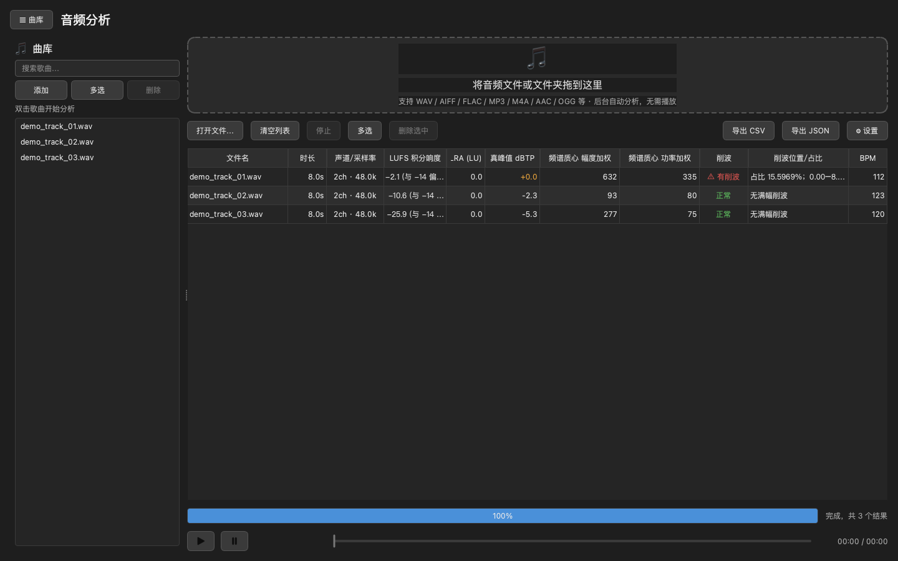
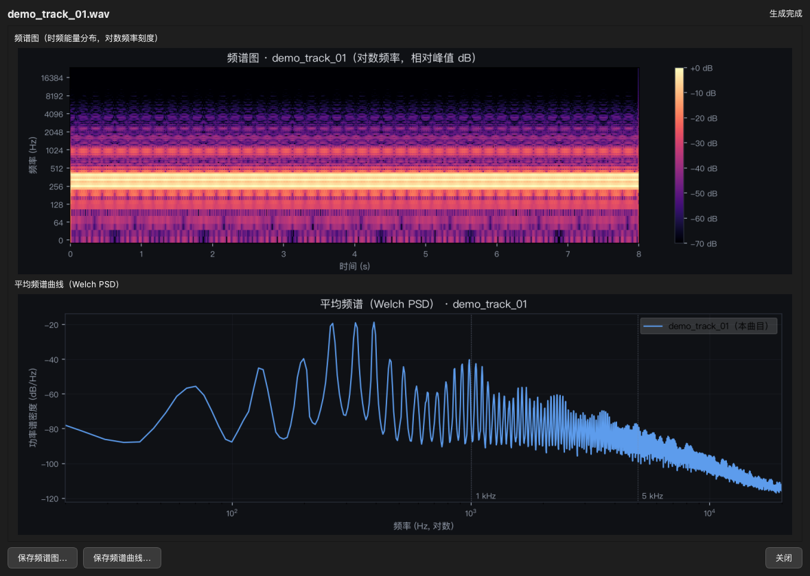

# 音频分析（macOS）

> 一个离线运行的 macOS 桌面音频**批量分析工具**——面向 AI 音乐标注 / 音频评测场景，
> 拖入文件即得到客观测量结果（响度、频谱、速度、削波）与频谱图表。



## 截图

**频谱图表（双击任意记录）**——频谱图 + 平均频谱曲线，深色报告风格，可保存 PNG 用于汇报：



**播放与削波标记**——进度条上的红色竖线标出每一处满幅削波的位置，拖过去即可复听：


## 功能

- **拖拽即用**：把一个或多个音频文件（或整个文件夹）拖入窗口，后台自动分析，无需播放监听。
- **逐文件客观测量**：

  | 指标 | 说明 |
  | --- | --- |
  | 积分响度 LUFS | EBU R128 / ITU-R BS.1770 积分响度（`I`） |
  | 响度范围 LRA | EBU Tech 3342 定义的响度范围，单位 LU |
  | 真峰值 dBTP | True Peak（4× 过采样），用于发现采样点间削波 |
  | 样本峰值 dBFS | 实际采样点峰值（0.0 dBFS = 满幅） |
  | 频谱质心·幅度加权 Hz | `Σf·|X| / Σ|X|`（逐帧质心时间平均）——**行业标准口径** |
  | 频谱质心·功率加权 Hz | `Σf·|X|² / Σ|X|²`（逐帧质心时间平均）——旧版口径 |
  | 速度 BPM | 自动节拍估计（tempogram），整数显示 |
  | 满幅削波检测 | 是否削波、削波样本占比、削波时间区间（分声道） |

- **结果表格**：所有文件逐条列出，削波 / 真峰值超限自动标红；BPM 列悬停可见原始检测值。
- **试听（播放）**：选中记录后按底部「▶ / ⏸」或**空格键**播放 / 暂停。
  - **可拖拽进度条**：点击 / 拖动定位；播放中拖动 → 松手后从新位置继续。
  - **削波位置标记**：进度条上的**红色竖线**标出所有满幅削波位置（毫秒级），拖到红线处即可复听。
  - 进度条右侧实时显示「已播时长 / 总时长」。
- **频谱图表（双击查看）**：双击表格任意记录 → 自动生成两张图（深色报告风格，可直接用于汇报）：
  - **频谱图（Spectrogram）**：时频能量分布热力图（对数频率，magma 配色，-70~0 dB）；
  - **平均频谱曲线（Welch PSD）**：横轴频率的功率谱密度曲线；
  - 每张图都可保存为 **PNG**（150 dpi / 1650px 宽）；重复打开秒显示（自带缓存）。
- **导出**：一键导出 **CSV**（UTF-8 BOM，Excel 可直接打开）或 **JSON**。
- **曲库**：可维护常用素材列表，双击条目即加入分析。
- **中英双语界面**：表头 / 导出字段 / 图表标题随语言切换。
- **深色 / 浅色 / 跟随系统**主题，界面全状态持久化。

## 运行（源码方式）

前置：Python 3.9+（推荐 3.11+）。

```bash
python3 -m venv .venv
source .venv/bin/activate
pip install -r requirements.txt
python main.py
```

> 首次运行若系统未装 ffmpeg，程序会通过 `static-ffmpeg` 自动获取静态二进制；也可手动 `brew install ffmpeg`。

## 命令行自测

```bash
python test_analyzer.py        # 生成已知参数的测试音频并输出测量结果
python analyzer.py 某文件.wav   # 输出单个文件的 JSON 结果
```

## 打包为 macOS 安装包

```bash
bash build_macos.sh
```

产物：`dist/音频分析.app`（可拖入「应用程序」）与 `dist/音频分析.dmg`（双击挂载安装）。

### 打包原理

1. **GUI 层**：PySide6（Qt），`--windowed` 无终端窗口，原生拖拽。
2. **分析引擎**：`ffmpeg` 的 `ebur128` 过滤器（libebur128 参考实现）测 LUFS / LRA / 真峰值；`ffprobe` 读采样率 / 声道 / 时长；`numpy` 做削波检测与频谱质心；`librosa` 做 BPM 估计。
3. **自包含**：`static-ffmpeg` 提供**静态链接**的 ffmpeg / ffprobe，通过 `--add-binary` 打进 `.app`，**目标机器无需预装 ffmpeg**。
4. **签名（可选）**：本地使用可直接运行；分发到他人电脑建议签名与公证。

   ```bash
   codesign --force --deep --sign - dist/音频分析.app
   codesign --verify --verbose dist/音频分析.app
   ```

   未签名应用首次打开时，可在「系统设置 → 隐私与安全性」中点击「仍要打开」。

   > 完整公证（消除「无法验证开发者」提示）需要 Apple Developer 账号：
   > ① 开发者证书签名 → ② 打包 zip → ③ `xcrun notarytool submit` → ④ `xcrun stapler staple`。

## 指标口径

- **LUFS 积分响度**：K 加权 + 绝对 / 相对门限（BS.1770-4），符合流媒体响度归一化口径（QQ 音乐 / 网易云 / Spotify / YouTube 目标约 -14 LUFS）。
- **LRA**：对 3s 短时响度块做 400ms 滑动窗统计，取第 10%~95% 分位差（EBU Tech 3342）。⚠ 时长 < 20s 或信号幅度恒定时参考性有限（可能出现 20 LU 上限值）。
- **削波判定（含防误报）**：连续 **≥ 3 个样本**触及满幅（|x| ≥ 0.999，即形成「平顶」）才判定为削波；孤立 1~2 个样本越过阈值（接近满幅的正常峰值）不会误报。间隔 ≤ 0.25s 的真削波段合并为同一区间；`真峰值 > 0 dBTP` 时另行提示采样点间削波风险。
- **立体声降混保护**：频谱质心 / BPM / 图表使用单声道降混时带反相保护——左右声道明显反相（会相互抵消）时自动改用差信号，避免把有声音的反相素材测成静音。
- **可靠性提示**：短音频（< 30 秒）的 LRA / BPM 会在悬停提示中注明参考性有限；纯静音等无有效值时显示「—」。
- **频谱质心（双口径）**：帧长 2048 / 跳 512，取逐帧质心的时间算术平均（与 librosa 标准用法一致，交叉验证偏差 < 0.2%）。
  - **幅度加权**（行业标准）：`Σ(f·|X|) / Σ|X|`
  - **功率加权**（旧版口径）：`Σ(f·|X|²) / Σ|X|²`
  - ⚠ 两种口径数值可能相差**数倍**（取决于频谱形状），引用或跨版本对比时务必注明口径。
- **BPM（速度）**：librosa tempogram 节拍估计（onset 强度包络 → 自相关 → 对数正态先验聚合，取时间中位数）。统一重采样到 22050 Hz、帧移 256；超过 3 分钟的音频只取中间 120 秒。⚠ 存在**半速 / 倍速乃至 1.5 倍**的天然歧义；弱节奏内容参考价值有限。

## 已知限制

- **长文件内存**：音频一次性解码到内存（1 小时 48 kHz 立体声 float32 约 1.4 GB），超大文件建议先分段。
- **BPM 歧义**：自动节拍估计的倍频歧义是方法本身的局限，可疑处建议人工复核。
- **图表标题**：图表内标题固定中文（界面语言不影响图内文字）。
- **反相素材**：降混保护覆盖「整体反相」；带局部相位处理的素材可能仍有轻微偏差。

## 文件结构

```
audio-batch-analyzer/
├── main.py            # GUI 入口（拖拽、后台线程、表格、播放、导出、图表窗口）
├── analyzer.py        # 测量引擎（ffmpeg ebur128 + numpy 削波 / 频谱质心 + librosa BPM）
├── charts.py          # 图表生成（频谱图 / 平均频谱曲线，matplotlib）
├── test_analyzer.py   # 自测脚本（生成已知参数的测试音频）
├── requirements.txt
├── build_macos.sh     # 打包脚本 → .app / .dmg
├── screenshots/       # README 截图
└── README.md
```

## 许可证

[MIT License](LICENSE)
